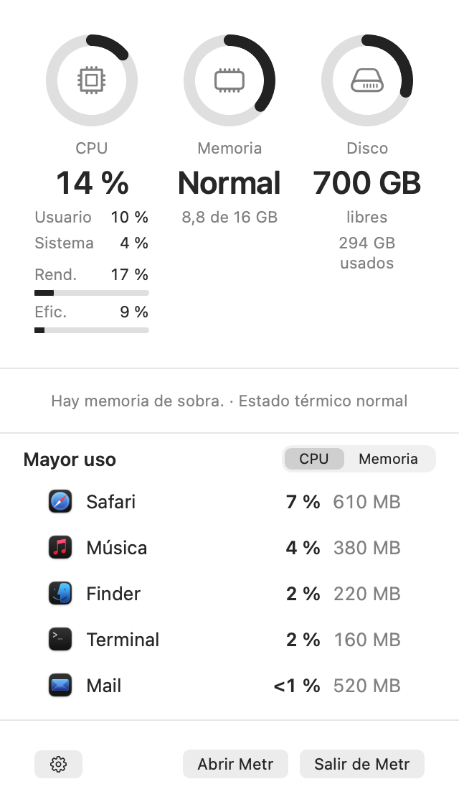
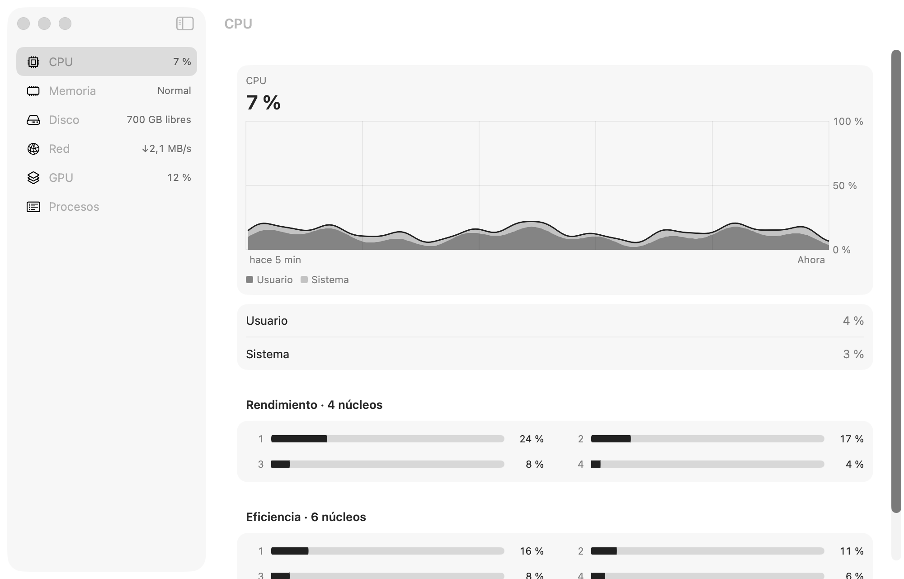
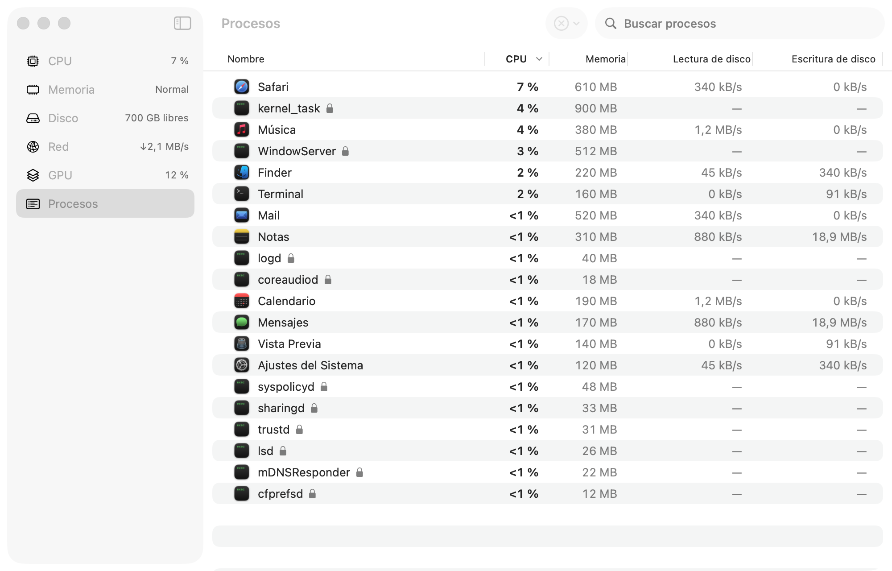

[English](README.md)

# Metr

Un monitor de sistema gratuito para la barra de menús de tu Mac: los números exactos y la app que está detrás de cada uno, en una ventana que parece hecha por Apple.

<picture>
  <source media="(prefers-color-scheme: dark)" srcset="docs/screenshots/menubar-dark.png">
  
</picture>

## Qué obtienes

- **Números exactos.** CPU, memoria y disco como tres anillos en la barra de menús, y las cifras reales a un clic.
- **La app detrás del número.** Ve qué app o proceso usa tu CPU y tu memoria, y cierra los que son tuyos.
- **Nativa, ligera y sin configurar.** Hecha para macOS 26 con el aspecto del sistema. Funciona bien desde el primer momento.

## Capturas de pantalla

<picture>
  <source media="(prefers-color-scheme: dark)" srcset="docs/screenshots/es/panel-dark.png">
  
</picture>

<picture>
  <source media="(prefers-color-scheme: dark)" srcset="docs/screenshots/es/window-cpu-dark.png">
  
</picture>

<picture>
  <source media="(prefers-color-scheme: dark)" srcset="docs/screenshots/es/window-processes-dark.png">
  
</picture>

## Instalación

1. Descarga `Metr-1.0.0.dmg` desde [Releases](https://github.com/LataroCaballero/Metr/releases) y arrastra Metr a Aplicaciones.
2. Abre Metr desde Aplicaciones. macOS dirá que no puede verificar Metr: pulsa Listo.
3. Abre Ajustes del Sistema › Privacidad y seguridad, baja hasta Seguridad, pulsa **Abrir igualmente** junto al mensaje de Metr, después **Abrir** e introduce tu contraseña. (En Latinoamérica el botón se llama **Abrir de todos modos**.)

Metr está firmada ad hoc y no está notarizada, porque es gratuita y no hay una cuenta de desarrollador de Apple detrás. Por eso macOS te pide confirmarla una vez.

Si el botón **Abrir igualmente** no aparece, es que ha desaparecido pasado un rato: abre Metr otra vez y volverá.

Opcionalmente, puedes quitar la marca de descarga solo de esta app:

```
xattr -dr com.apple.quarantine /Applications/Metr.app
```

Para comprobar tu descarga, ejecuta `shasum -a 256 Metr-1.0.0.dmg` y compara el resultado con el SHA-256 de las notas de la versión.

## Mantén Metr en la barra de menús

¿No ves los anillos? Activa Metr en Ajustes del Sistema › Barra de menús.

## Abrir al iniciar sesión

Activa **Abrir al iniciar sesión** en los Ajustes de Metr (el engranaje del panel). Funciona mejor cuando Metr está en `/Applications`.

## Privacidad

Metr no realiza conexiones de red: sin telemetría, sin analíticas, sin comprobación de actualizaciones, sin cuentas. Todo lo que muestra se lee localmente en tu Mac.

Compruébalo tú mismo con `nettop` o un cortafuegos como Little Snitch, o ejecuta el script de comprobación en `scripts/verify/` (`scripts/verify/no-network.sh`).

## Huella

<!-- footprint:start -->
| Estado | CPU (% de un núcleo) | Memoria | Activaciones/s |
|---|---|---|---|
| En reposo (panel cerrado), compilación de lanzamiento | 0,22 % | 14,9 MB | 1,9 |
| Panel abierto, compilación optimizada con ganchos de medición | 5,38 % | 16,7 MB | 3,8 |
| Ventana abierta, compilación optimizada con ganchos de medición | 3,67 % | 83,6 MB | 7,8 |

Medido en un MacBook Air (Apple M4), macOS 26.5.2, Metr 1.0.0 (compilación 167, CDHash ee7456086402), 2026-11-18.

Método: `scripts/perf/` mide el proceso de Metr con `proc_pid_rusage`. En reposo son 300 segundos con la compilación de lanzamiento; panel y ventana son 60 segundos con una compilación optimizada con ganchos de medición. Panel abierto incluye el proceso hijo `top` de Metr: Metr 0,91 % más top 4,47 %. La fila en reposo cumple el presupuesto del proyecto (0,25 % de CPU, 3,0 activaciones/s); midió 0,220 % antes de redondear.

No se hizo la prueba de 24 horas con esta compilación: el responsable del proyecto decidió omitirla en la 1.0.0. La fila en reposo es una medición de 300 segundos, no una prueba larga.

Problema conocido: la memoria crece un poco con cada apertura y cierre de la ventana (un problema de AppKit en el marco de la ventana). Medido: 2,1 MB en 10 ciclos de apertura y cierre, sin contar el primero, que carga los frameworks de la ventana.
<!-- footprint:end -->

## Requisitos

Apple Silicon y macOS 26 o posterior. Metr está firmada ad hoc y no está notarizada, por eso hace falta Abrir igualmente.

## Licencia

MIT. Consulta [LICENSE](LICENSE).
