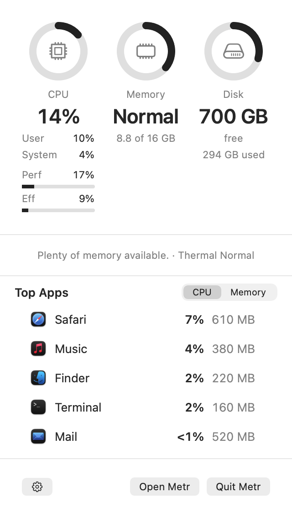
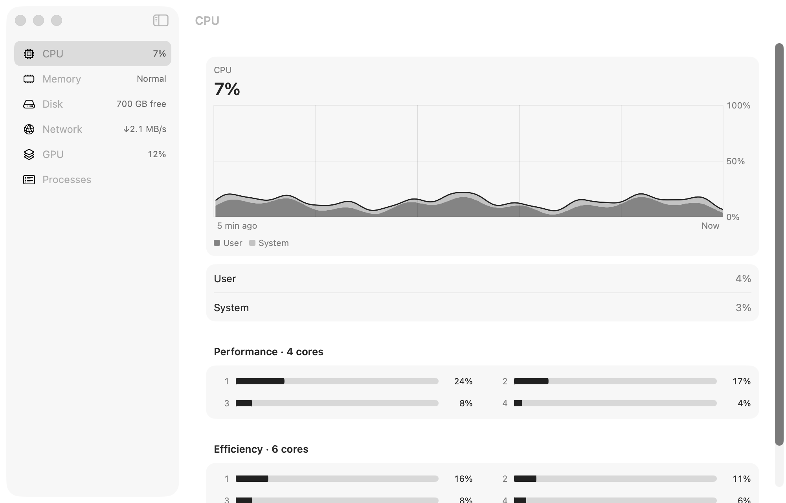
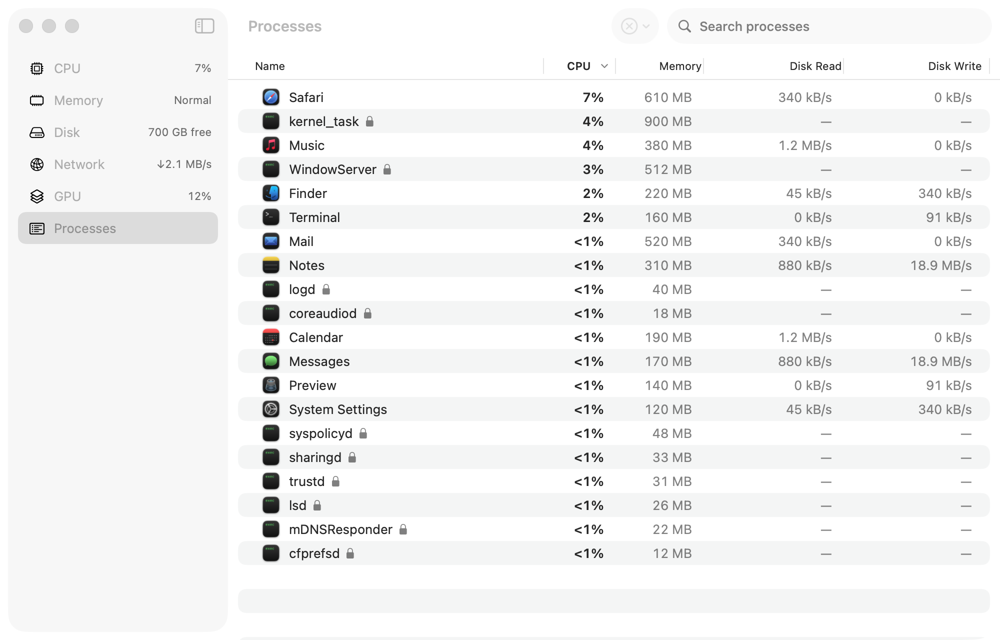

[Español](README.es.md)

# Metr

A free system monitor for your Mac's menu bar: the exact numbers, and the app behind each one, in a window that looks like Apple made it.

<picture>
  <source media="(prefers-color-scheme: dark)" srcset="docs/screenshots/menubar-dark.png">
  
</picture>

## What you get

- **Exact numbers.** CPU, memory and disk as three rings in the menu bar, and the real figures one click away.
- **The app behind the number.** See which app or process is using your CPU and memory, and quit the ones that are yours.
- **Native, light, no setup.** Built for macOS 26 with the system's own look. It works well the moment you open it.

## Screenshots

<picture>
  <source media="(prefers-color-scheme: dark)" srcset="docs/screenshots/en/panel-dark.png">
  
</picture>

<picture>
  <source media="(prefers-color-scheme: dark)" srcset="docs/screenshots/en/window-cpu-dark.png">
  
</picture>

<picture>
  <source media="(prefers-color-scheme: dark)" srcset="docs/screenshots/en/window-processes-dark.png">
  
</picture>

## Install

1. Download `Metr-1.0.0.dmg` from [Releases](https://github.com/LataroCaballero/Metr/releases) and drag Metr to Applications.
2. Open Metr from Applications. macOS says it can't verify Metr: click Done.
3. Open System Settings › Privacy & Security, scroll to Security, click **Open Anyway** next to the Metr message, then **Open** and enter your password.

Metr is ad-hoc signed and not notarized, because it is free and has no Apple developer account behind it. That is why macOS asks you to confirm it once.

If the **Open Anyway** button isn't there, it has disappeared after a while: open Metr again and it comes back.

Optionally, you can clear the download flag for this one app only:

```
xattr -dr com.apple.quarantine /Applications/Metr.app
```

To check your download, run `shasum -a 256 Metr-1.0.0.dmg` and compare the result with the SHA-256 in the release notes.

## Keep Metr in the menu bar

Don't see the rings? Turn Metr on in System Settings › Menu Bar.

## Open at login

Turn on **Open at login** in Metr's Settings (the gear in the panel). It works best when Metr is in `/Applications`.

## Privacy

Metr makes no network connections: no telemetry, no analytics, no update check, no accounts. Everything it shows is read locally from your Mac.

Watch it yourself with `nettop` or a firewall such as Little Snitch, or run the check script in `scripts/verify/` (`scripts/verify/no-network.sh`).

## Footprint

<!-- footprint:start -->
| State | CPU (% of one core) | Memory | Wakeups/s |
|---|---|---|---|
| Idle (panel closed), release build | 0.22% | 14.9 MB | 1.9 |
| Panel open, optimized build with measurement hooks | 5.38% | 16.7 MB | 3.8 |
| Window open, optimized build with measurement hooks | 3.67% | 83.6 MB | 7.8 |

Measured on a MacBook Air (Apple M4), macOS 26.5.2, Metr 1.0.0 (build 167, CDHash ee7456086402), 2026-11-18.

Method: `scripts/perf/` measures Metr's own process with `proc_pid_rusage`. Idle is 300 seconds on the release build; panel and window are 60 seconds on an optimized build with measurement hooks. Panel open includes Metr's streamed `top` child: Metr 0.91% plus top 4.47%. The idle row is held to the project budget (0.25% CPU, 3.0 wakeups/s); it measured 0.220% before rounding.

The 24 hour soak on this build is pending.

Known issue: memory grows a little with each open and close of the window (an AppKit issue in the window chrome). Measured: 2.1 MB over 10 open and close cycles, not counting the first, which loads the window's frameworks.
<!-- footprint:end -->

## Requirements

Apple Silicon and macOS 26 or later. Metr is ad-hoc signed and not notarized, which is why Open Anyway is needed.

## License

MIT. See [LICENSE](LICENSE).
